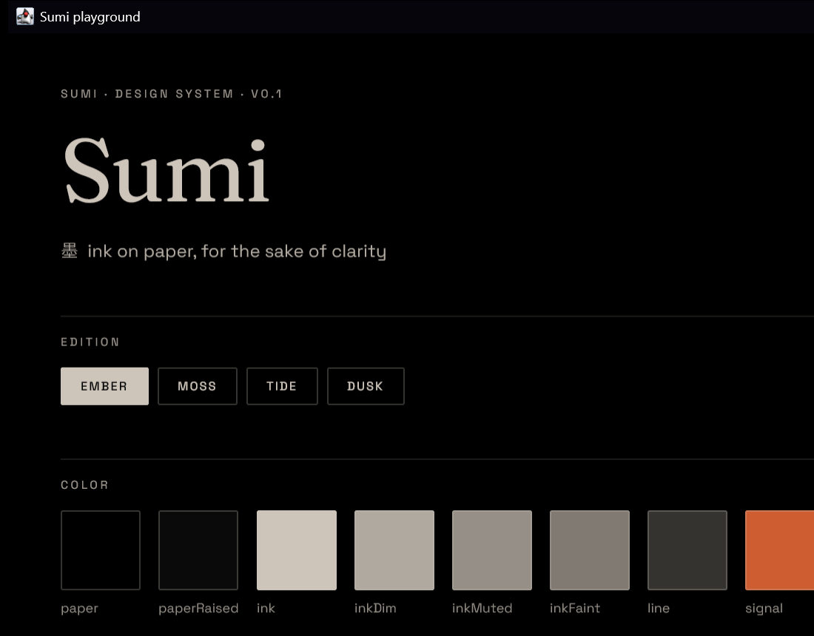
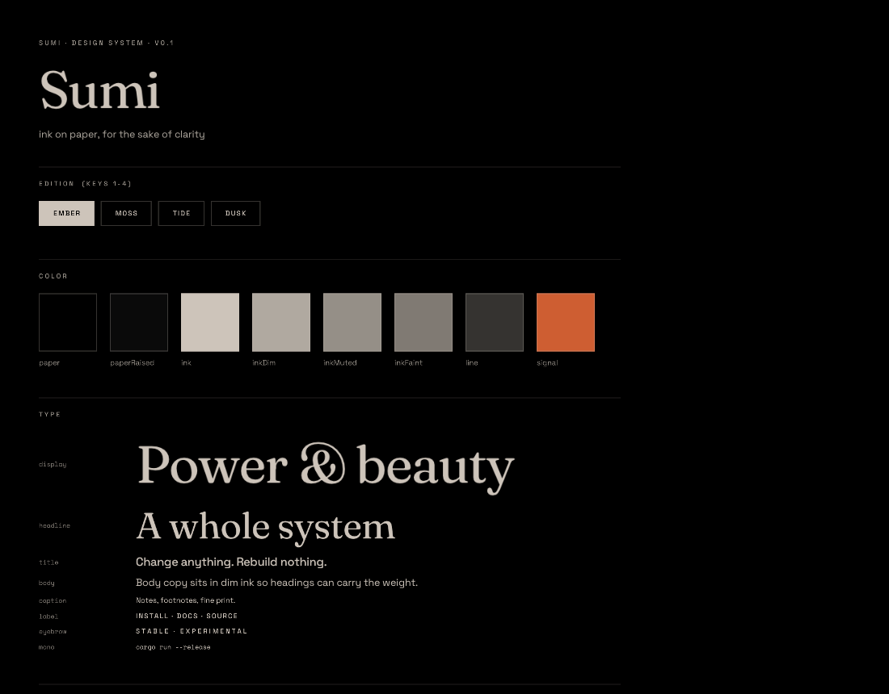

# Sumi 墨

A personal design system: ink on paper. Its look started from [ryoku.dev](https://ryoku.dev): near-black paper, warm bone ink, one signal color, an editorial serif paired with a technical grotesk.

**▶ [Try the Rust playground in your browser](https://benhritzko.github.io/sumi/)** (Rust + raylib compiled to WebAssembly)

The same tokens are implemented twice:

| | |
|---|---|
| `kotlin/` | Compose Multiplatform library (`:sumi`) and a desktop playground (`:playground`) |
| `rust/` | raylib, with no UI library. Tokens, fonts, and a tiny immediate-mode UI written by hand. Runs on desktop and in the browser |

| Compose | Rust + raylib |
|---|---|
|  |  |

## Tokens (v0.1)

| Layer | What |
|---|---|
| **Primitive colors** | 4 editions × (paper, paper-raised, 4-step ink ramp, signal) |
| **Semantic colors** | `paper`, `ink`, `inkDim`, `inkMuted`, `inkFaint`, `signal`. Lines and tints are derived from ink at fixed opacities |
| **Editions** | `Ember` (default), `Moss`, `Tide`, `Dusk`. Each one remaps the semantic colors to a different primitive family |
| **Type** | Fraunces (display), Space Grotesk (UI), Space Mono (code); 9 styles from `display` to `eyebrow` |
| **Space** | 4px base: `s1`–`s8` = 4, 8, 12, 16, 24, 32, 48, 64 |
| **Shape** | 2px radius, 1px hairline |
| **Motion** | `snap` 90ms, `move` 170ms, `swap` 210ms; `easeOut` = cubic-bezier(.215, .61, .355, 1) |

## Run

**Kotlin** (JDK 17+):

```bash
cd kotlin && ./gradlew :playground:run
```

**Rust** (Windows needs: Visual Studio C++ tools + Windows SDK, CMake, LLVM). Run it from PowerShell or cmd, not Git Bash, because Git Bash's `link` shadows the MSVC linker:

```powershell
cd rust; $env:LIBCLANG_PATH = "C:\Program Files\LLVM\bin"; cargo run
```

**Web:** every push to `main` that touches `rust/` triggers [`.github/workflows/web.yml`](.github/workflows/web.yml). It compiles the same code to WebAssembly with emscripten and deploys `rust/web/index.html` + `sumi.js` + `sumi.wasm` to GitHub Pages. Fonts are compiled into the binary with `include_bytes!`, so desktop and web share one code path.

## Rust exercises

Roughly in order. Each one teaches a Rust concept by growing the design system:

1. **Add a `Variant::Signal` button** (signal fill, `on_signal` text). *Enums and `match` exhaustiveness: the compiler shows you every place to update.*
2. **Pull layout out of `main.rs`** into a `Column` helper that tracks `y` and gap. *Structs, `&mut self`, ownership.*
3. **Replace `&'static str` ids with hashed ids** so buttons can be created in loops. *Traits (`Hash`), generics.*
4. **Add a `Text` input field**: focus, caret, typing via `get_char_pressed`. *`Option`, `String` vs `&str`.*
5. **Load tokens from a shared `tokens.json`** with `serde`, and generate the Kotlin side from it too. *Crates, error handling with `Result` and `?`.*
6. **HiDPI**: set `FLAG_WINDOW_HIGHDPI` and scale font atlases. *Working through raylib's C API surface.*

Fonts are under the SIL Open Font License (`FONTS-OFL.txt`).
